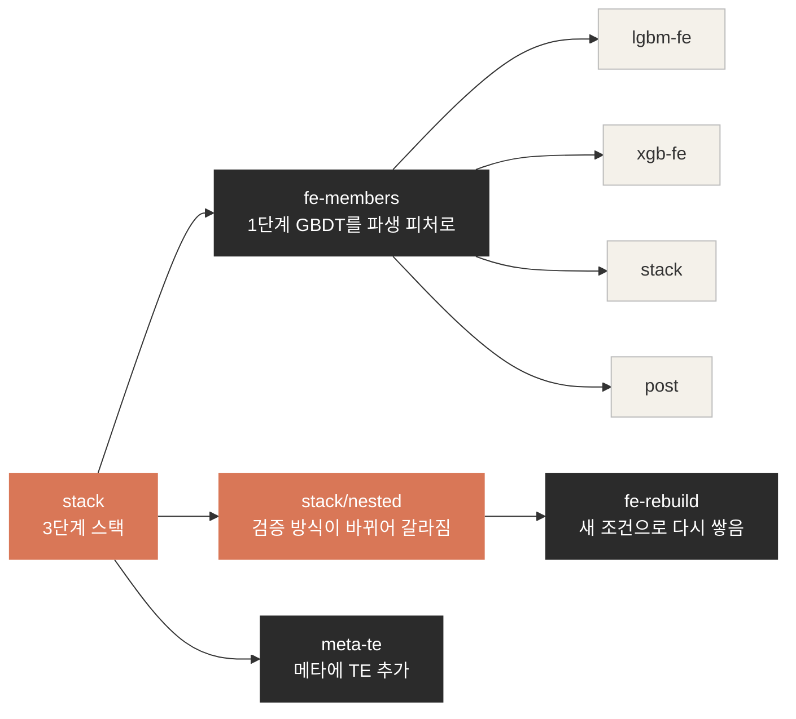
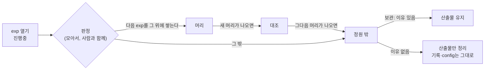

<div align="center">

# competition-setup

### 대회 첫날 한 번 실행하면, 마지막 날까지 실험 기록이 무너지지 않는다

Kaggle · DACON 같은 리더보드 대회를 시작할 때 스펙을 확정하고,<br/>
실험 기록 구조와 이후 모든 세션이 따를 규칙(`CLAUDE.md`)을 한 번에 심는 **Claude 스킬**

<br/>

[](#설치)
[](#claude-code)
[](#claudeai)
<br/>
[](https://www.kaggle.com/competitions)
[](https://dacon.io/competitions)


</div>

---

## 왜 필요한가

대회에서 비용이 가장 큰 실패는 모델이 나쁜 것이 아니라 **되돌아가는 것**이다.

- validation 설계가 틀렸다는 걸 3주차에 알면, 그동안의 실험 기록이 전부 무효가 된다
- 제출 형식을 마감 전날 확인하면, 순위표에 남는 건 오류 메시지다
- 실험을 쌓기만 하면, 2주 뒤에는 무엇이 살아 있는 결과인지 아무도 모른다

마지막 항목은 실제로 겪은 일이다. 한 대회를 마감 직전까지 달린 뒤의 실험 폴더는 이랬다.

| 증상 | 그때 수치 |
|---|---:|
| 번호 붙은 실험 폴더 | **386개** |
| "살아 있는 머리"를 적어 둔 한 줄 | 머리 **25개**, 8,258자 |
| 판정을 기다리는 실험 (상한 5) | **32개** |
| 결합 실험이 몰린 기록 파일 하나 | **2,828줄** |

지금의 구조는 이 경험을 거꾸로 따라가며 만들었다.

---

## 핵심 아이디어 — 줄기 · exp · 실험

실험 기록을 시간순이나 "무엇을 바꿨나"로 나누지 않고, **모델 구조를 따라** 나눈다.



| 단위 | 무엇인가 | 예 |
|---|---|---|
| **줄기** | 대략적인 모델 구조. `BRANCH.md`에 구조와 상태를 적는다 | `stack`, `gbdt-single`, `cnn-finetune` |
| **하위 줄기** | 줄기가 갈라져야 할 이유가 생겨 쪼개진 것 | `stack/nested`, `stack/no-te` |
| **exp** | 그 구조를 어떻게 채울지 — 어떤 모델을 넣고 어떤 피처를 쓰는지 | `fe-members`, `prune-fwd8` |
| **실험** | 그 exp 안에서 돌린 것. 한 기록 파일(`EXP.md`)에 여럿이 모인다 | `lgbm-fe`, `stack`, `meta-te`, `post` |

> 이 설명들은 예시다. 무엇을 줄기·exp·실험으로 나눌지는 사용자가 정하면 그대로 따르고, 아니면 Claude가 판단해서 나눈 뒤 알린다.

### 이것을 지키는 네 가지 장치

| | 장치 | 왜 |
|:-:|---|---|
| 1 | **번호 대신 이름** | 단조 증가 번호는 "새 번호 = 새 실험"이라 하나 더 만드는 비용이 0이다. 이름을 지어야 하면 "이미 있는 것의 일부인가?"를 먼저 보게 된다 |
| 2 | **줄기마다 정원** | 머리 1 · 대조 1 · 진행중 4. 정원이 차면 판정을 해야 새 exp를 열 수 있다 |
| 3 | **남길 이유는 따로** | 판정(채택·보류·기각)과 보관을 한 값에 묶지 않는다. 나중에 다시 볼 이유가 있으면 `보관:` 한 줄 |
| 4 | **기록은 지우지 않는다** | 정리할 때 지우는 건 예측·체크포인트 같은 산출물뿐이다. config가 남아 있어 언제든 다시 만든다 |



---

## 무엇을 하나

이 스킬은 **세팅만** 한다. 모델을 학습하지도, 하이퍼파라미터를 고르지도 않는다. 대신 그 뒤의 모든 세션이 같은 규칙으로 일하도록 파일을 남긴다.

| 단계 | 하는 일 |
|:-:|---|
| **1** | **대회 스펙 인터뷰** — 지표의 정확한 정의, 제출 형식, 제출 제한, 외부 데이터 허용, 마감. 추정해서 채우지 않고 모르는 건 `미확인`으로 남긴다 |
| **2** | **디렉토리 생성** — `data/`, `exp/`, `sub/`, `docs/`, `src/`와 `.gitignore` |
| **3** | **스펙 문서화** — `docs/competition-spec.md`, `EDA.md`, 지표 스텁 `src/metric.py`, 경로 모듈 `src/paths.py`, 정리 점검 `src/check_exp.py` |
| **4** | **줄기 생성** — 입력 표현이나 모델 구조가 다른 최상위 줄기 후보 2~3개를 제안하고, 고른 것마다 `BRANCH.md`를 쓴다. 실험 축 목록도 이때 정한다 |
| **5** | **기록 형식 확정** — 분할 산출물, 변동폭 정의, exp 구성 줄, 실험 필드를 이 대회에 맞춘다. fold별·run별 점수가 남지 않는 형식은 받지 않는다 |
| **6** | **규칙 내보내기** — `CLAUDE.md`와 참조 문서를 쓴다. 이 스킬이 끝난 뒤에는 이 파일들이 규칙이 된다 |
| **7** | **완료 보고** — 만든 파일, 미확인 항목, 다음 세션이 순서대로 할 세 가지 |

### 세팅이 끝난 프로젝트

```text
대회 루트/
├── CLAUDE.md                  규칙과 진입점. 매 세션 자동으로 읽힌다
├── EDA.md                     데이터를 봐서 알아낸 것 (덮어쓰기)
├── docs/
│   ├── competition-spec.md    대회 규칙 · 결정 기록
│   ├── validation-design.md   fold 설계 · leak 체크 · 변동폭 측정
│   ├── cv-lb-diagnosis.md     검증 점수와 LB가 어긋날 때
│   └── cleanup-policy.md      세션 끝의 정리 절차
├── exp/
│   ├── TEMPLATE.md            줄기 문서 · exp 문서 형식, 축 목록
│   └── <줄기>/
│       ├── BRANCH.md          구조 · 상태 · 다음 후보
│       └── <exp>/
│           ├── EXP.md         구성 · 대조 · 결론 + 실험별 결과
│           └── <실험>/         config.yaml · metrics.json · 예측
├── src/
│   ├── metric.py              검증 전까지 점수를 믿지 않는다
│   ├── paths.py               실험 경로 · 이름 규칙
│   └── check_exp.py           정리 점검 (아무것도 지우지 않음)
├── data/{raw,processed}/
└── sub/<실험 경로>.csv
```

---

## 설치

### Claude Code

사용자 스킬 폴더에 그대로 받는다.

```bash
git clone https://github.com/elelelee/competition-setup ~/.claude/skills/competition-setup
```

새 대회 폴더에서 Claude Code를 열고 부른다.

```text
/competition-setup
```

> `SKILL.md`에 `disable-model-invocation: true`가 있어서, 직접 부를 때만 실행된다.

### claude.ai

claude.ai 스킬은 로컬 폴더와 동기화되지 않으므로 zip으로 따로 올린다.

1. 이 저장소를 `competition-setup/` 폴더로 받는다 (`SKILL.md`와 `assets/`만 있으면 된다)
2. 채팅에서 자동으로 불리게 하려면 `SKILL.md` 머리말에서 `disable-model-invocation: true` 줄을 지우고, `description`에 "대회 나가려는데 프로젝트 세팅해줘" 같은 트리거 문구를 더한다
3. `competition-setup/` 폴더째 zip으로 묶어 **설정 → Capabilities → Skills**에서 업로드한다

---

## 저장소 구성

| 파일 | 역할 | 프로젝트로 |
|---|---|---|
| [`SKILL.md`](SKILL.md) | 세팅 절차 1~7단계 | — |
| [`assets/CLAUDE.md.template`](assets/CLAUDE.md.template) | 규칙 파일. 자리표시자를 채워 `CLAUDE.md`가 된다 | `CLAUDE.md` |
| [`assets/experiment-log.template.md`](assets/experiment-log.template.md) | 줄기·exp 문서 형식과 예시, 축 목록 | `exp/TEMPLATE.md` |
| [`assets/competition-spec.template.md`](assets/competition-spec.template.md) | 대회 스펙과 결정 기록 | `docs/` |
| [`assets/EDA.template.md`](assets/EDA.template.md) | 데이터 관찰 범주 | `EDA.md` |
| [`assets/validation-design.md`](assets/validation-design.md) | split 선택, leak 체크리스트, adversarial validation, 변동폭 | `docs/` |
| [`assets/cv-lb-diagnosis.md`](assets/cv-lb-diagnosis.md) | CV–LB 갭 패턴 판정과 대응 | `docs/` |
| [`assets/cleanup-policy.md`](assets/cleanup-policy.md) | 무엇을 남기고 무엇을 지우는지, 판정 세션 | `docs/` |
| [`assets/paths.py`](assets/paths.py) | `run_dir`, `new_exp_dir`, `new_run_dir` | `src/` |
| [`assets/check_exp.py`](assets/check_exp.py) | 기록 누락·정원·이름·헤딩 점검, 지울 산출물 목록 | `src/` |

---

## 설계 원칙

<details>
<summary><b>되돌아감을 먼저 막는다</b></summary>

분할 파일이 없으면 어떤 학습도 시작하지 않는다. 지표 구현을 완전 예측·상수 예측으로 검증하기 전에는 검증 점수를 믿지 않는다. 분할을 고정하기 전에 돌린 실험은 나중에 비교 대상이 되지 못하고 결국 버려진다.
</details>

<details>
<summary><b>판정은 모아서, 사람과 함께</b></summary>

실험 직후에는 `진행중`으로만 적는다. 판정은 여러 개를 모아 사용자와 함께 한다. 개선폭 대 변동폭, fold별 일관성, 분산 변화 — 세 신호를 함께 보고, 단일 수치로 판정하지 않는다. 남은 제출 횟수나 마감까지 기간처럼 문서에 없는 정보가 판정을 좌우하기 때문이다.
</details>

<details>
<summary><b>기각을 아낀다</b></summary>

잘못 기각하면 그 방향을 다시 보지 않게 되고, 잘못 보류하면 나중에 재판정할 뿐이다. 개선폭이 변동폭보다 작다는 것만으로는 기각하지 않는다. 그래서 `보류`가 대부분을 차지하는 것이 정상이다.
</details>

<details>
<summary><b>같은 사실은 한 곳에</b></summary>

수치는 exp 문서에만, 규칙은 `CLAUDE.md`에만 둔다. 같은 사실이 두 곳에 있으면 언젠가 어긋나고, 어긋나면 어느 쪽이 맞는지 판정할 수 없다. `EDA.md`와 줄기 문서는 현재 상태만 남기도록 덮어쓴다.
</details>

<details>
<summary><b>규칙이 아니라 예시와 판단</b></summary>

줄기가 갈라지는 이유(비교 조건 변화, 최종 제출에서의 다른 역할, 같은 머리에서 두 방향)는 예시이고 거기에 한정되지 않는다. 기계적으로 확인할 수 있는 것(이름 규칙, 문서 위치, 정원, 헤딩)만 스크립트가 강제하고, 경계가 흐린 판단은 사람과 Claude에게 남긴다.
</details>

---

<div align="center">
<sub>모델링 자체는 이 스킬의 범위 밖이다 — 세팅이 끝나면 생성된 <code>CLAUDE.md</code>와 <code>docs/</code>가 대회 끝까지 규칙이 된다.</sub>
</div>
